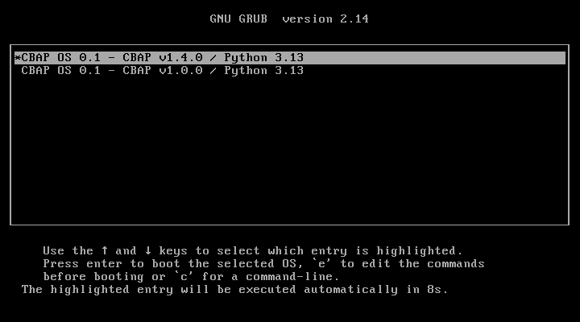
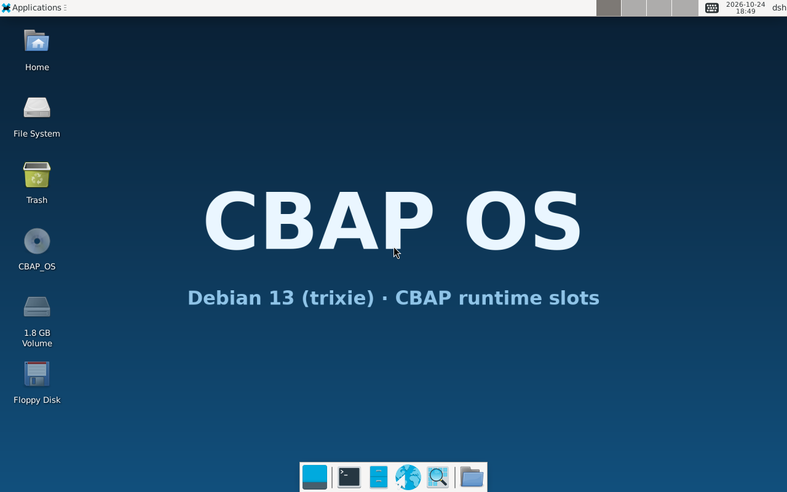
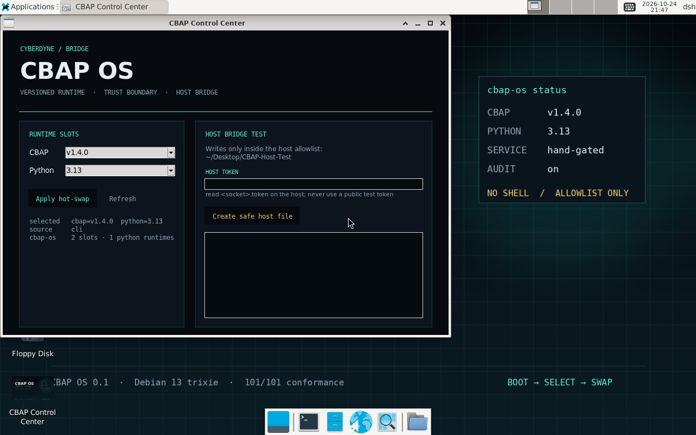

# CBAP OS —— 专门给 CBAP 用的可版本化操作系统

CBAP OS 是从 **DSH OS** 长出来的：Debian 13 (trixie) 由 `mmdebstrap`
手工拼成，桌面栈保持 XFCE；上面加一层 **CBAP 运行时**：

```text
Debian 13
  └── Python 3
  └── /opt/cbap-os/versions/cbap/<version>      CBAP 源码槽
  └── /opt/cbap-os/versions/python/<version>    Python 运行时槽
  └── /opt/cbap-os/current/{cbap,python}        当前挂载点
  └── CBAP Kernel systemd 服务
```

目标不是“装一份 CBAP”，而是：

> **每次开机可以选择挂哪一个 CBAP 版本、哪一个 Python 版本；进系统后还能热切换。**

## 当前能力

| 能力 | 状态 |
|---|---|
| Debian 13 + XFCE 底座 | 继承 DSH OS 脚本 |
| Python 3 + `cbap` 命令 | 构建时安装 |
| CBAP 多版本槽 | `v1.0.0` / `v1.4.0` 可同时安装 |
| Python 多版本槽 | 支持自包含 prefix；默认系统 Python 槽 |
| 开机选择版本 | tty1 菜单 + 内核 cmdline |
| 登录后热切换 | `cbap-os use --cbap ... --python ...` |
| 失败回滚 | 停止服务 → 切挂载 → 起服务；失败恢复旧槽 |
| 真实镜像构建 | 本次改动未重新跑 QEMU 构建 |
| 多 Python 二进制 | 机制已留；默认只带系统 Python |

## 启动后的样子

```text
CBAP OS 0.1
  ├── Python 3.13 (system slot)
  ├── CBAP v1.4.0 (default)
  ├── CBAP v1.0.0 (可选)
  └── cbap.service（有 hand 才启动）
```

`cbap.service` 的运行条件是：

```text
存在 /run/cyberdyne/cyberdyne.sock
```

没有 hand 时服务被 systemd 条件跳过，不会让系统卡在 failed 状态。

## 开机选择

### ISO / GRUB

ISO 的版本选择在 GRUB 菜单里，每个已安装 CBAP 槽一项：

```text
CBAP OS 0.1 - CBAP v1.4.0 / Python 3.13
CBAP OS 0.1 - CBAP v1.0.0 / Python 3.13
```



选中的版本通过内核参数传入：

```text
cbap.cbap=v1.4.0 cbap.python=3.13
```

### 安装盘 / tty1

安装到磁盘的系统还启用了 `cbap-os-select.service`，在 tty1 显示：

```text
CBAP version:
  [1] v1.4.0
  [2] v1.0.0
Python runtime:
  [1] 3.13
```

10 秒不选就用默认值。选完写：

```text
/etc/cbap-os/selection.json
```

这条 tty1 路径在 QEMU 里没有成功显示，ISO 因此改用 GRUB 菜单。

### 无头 / QEMU 串口

没有 tty1 菜单时，用内核参数：

```text
cbap.cbap=v1.4.0 cbap.python=3.13
```

或显式关闭菜单：

```text
cbap.nomenu
```

## 登录后热切换

```bash
sudo cbap-os list
sudo cbap-os status
sudo cbap-os use --cbap v1.0.0 --python 3.13
sudo cbap-os rollback
```

`use` 的实际动作：

```text
校验版本槽
停止 cbap.service（如果它正在跑）
卸载 current/cbap、current/python
重新 bind mount 到目标槽
原子写 selection.json
如果服务原来在跑，重启服务
任一步失败 → 恢复旧挂载和旧 selection
```

Python 是解释器，所以这里的“热插拔”准确说是：

> **控制面热切换 + CBAP 进程重启**，不是在一个已经加载 libpython 的进程里换解释器。

## 目录

```text
/opt/cbap-os/
  versions/cbap/<version>/      不可变 CBAP 源码
  versions/python/<version>/    Python 运行时 / prefix
  current/cbap/                 bind mount
  current/python/               bind mount
  bin/cbap-os                   版本管理器
  bin/cbap                      用当前选择运行 CBAP

/etc/cbap-os/
  selection.json                当前/下次启动选择
  runtime.env                   hand、socket、audit 路径

/usr/local/bin/
  cbap-os
  cbap
  cbap-python                   当前选择的 Python
  cbap-service                  systemd 入口
```

## 构建

沿用 DSH OS 的底座流程：

```bash
pkexec bash 拼装.sh
pkexec bash 本轮A-开机看桌面.sh
pkexec bash 收尾.sh
pkexec bash 收尾C-中文接线.sh
pkexec bash 收尾E-直通能力.sh
```

再加 CBAP 层：

```bash
# 默认安装 v1.4.0 + v1.0.0；本地源码可指定 CBAP_SRC
pkexec env CBAP_SRC=/path/to/cyberdyne-bridge \
  CBAP_VERSIONS="v1.0.0 v1.4.0" \
  bash 收尾F-CBAP-OS.sh
```

然后品牌化并重做镜像：

```bash
bash 改名CBAP-OS.sh
pkexec bash 本轮B-做镜像和开机.sh
```

启动：

```bash
bash 启动CBAP-OS.sh
```

> 本次没有实际重跑 Debian 拼装/QEMU。上面是构建路径，不是“已产出镜像”的声明。

## 版本槽怎么加

CBAP：

```bash
sudo bash cbap-os/install.sh --root / \
  --cbap-version v1.0.0 --force
```

Python：准备一个自包含 prefix（例如 python-build-standalone）：

```bash
sudo bash cbap-os/install.sh --root / \
  --python-prefix /opt/python-3.11 \
  --python-version 3.11
```

默认 `--python-mode link` 只建立指向 prefix 的槽。真正的多解释器需要自包含 prefix；`--python-mode copy` 仍是实验项。

## ISO

仓库现在带 **可启动 live ISO 构建器**：

```bash
bash cbap-os/iso/build-iso.sh \
  --rootfs "$HOME/拼装/构建/kernel-rootfs" \
  --cbap-src /path/to/cyberdyne-bridge \
  --output "$HOME/拼装/构建/CBAP-OS.iso"
```

依赖：

```text
mtools
grub-pc-bin
grub-efi-amd64-bin
xorriso
squashfs-tools
cpio
busybox-static
```

ISO 结构：

```text
/boot/vmlinuz
/boot/initrd.img
/boot/grub/grub.cfg
/casper/filesystem.squashfs
```

启动链：

```text
GRUB -> vmlinuz + 最小 busybox initramfs
     -> 找 /casper/filesystem.squashfs
     -> squashfs 只读 lower + tmpfs upper overlay
     -> switch_root /sbin/init
```

这不需要 `live-boot` 包，也不把 4G rootfs 直接塞进 ISO 的 ext4；
rootfs 在 ISO 里是压缩 squashfs。

**当前这张 ISO 已在 QEMU/KVM 里启动到 CBAP OS 桌面**：

```text
QEMU -m 4096 (4G 上限)
GRUB BIOS + UEFI
CBAP OS 0.1
CBAP v1.4.0 (默认) / v1.0.0
Python 3.13
```

测试截图：



### CBAP Control Center

桌面上的 `CBAP Control Center` 是 CBAP OS 的本地控制面板：



```text
当前 CBAP / Python
版本槽列表
Apply hot-swap（pkexec）
Host Bridge Test（写宿主机 allowlist）
```

Host Bridge 现在暴露 5 个 CBAP device_id：

```text
host://desktop         filesystem compatibility
host://fs              allowlisted filesystem
host://display         Wayland screenshot
host://input/mouse     opt-in X11/XWayland pointer
host://input/keyboard  opt-in X11/XWayland keyboard
```

输入默认关闭；宿主机启动 bridge 时显式加 `--enable-input` 才会打开。
原生 Wayland 键鼠注入尚未实现，当前输入后端是 X11/XWayland。

Host Bridge 的安全测试说明在主仓：

```text
cyberdyne-bridge/docs/CBAP-OS-Host-Bridge.md
```

ISO 不入库（`.gitignore` 排除 `*.iso`）。

## 测试

宿主上无 root 跑选择器/安装器测试：

```bash
./cbap-os/tests/run.sh
```

测试覆盖：

```text
版本目录发现
CBAP/Python 同时切换
只切 CBAP 时保留 Python
开机重新挂载
rollback
非法/歧义版本拒绝
安装器生成版本槽和 selection
hand-present 条件
```

## 文件

```text
拼装.sh                 主底座构建；默认带 CBAP group
加包.sh                 追加包；新增 CBAP group
收尾F-CBAP-OS.sh        安装 CBAP OS runtime layer
改名CBAP-OS.sh          CBAP OS 品牌化
启动CBAP-OS.sh          启动 CBAP OS 镜像
cbap-os/                CLI、systemd、安装器、测试
  bin/cbap-os           版本选择/热切换
  bin/cbap              当前 CBAP runner
  bin/cbap-service      systemd 服务入口
  install.sh            往 rootfs 安装
  systemd/              选择、挂载、CBAP 服务单元
  iso/                  live ISO（GRUB + squashfs + 自定义 initramfs）
  tests/                宿主级无 root 测试
CBAP-OS-看这里.txt       给最终用户的操作说明
```

DSH OS 的原始脚本仍保留；CBAP OS 是在其上加层，不是把底座推倒重写。

## 边界 / 诚实交代

```text
没有在真实 QEMU 里验证本次 CBAP 版本菜单
没有做 TPM/签名/远程证明
没有在切换时迁移正在执行的 CBAP lease
默认 Python 槽链接系统 /usr/bin/python3，不是独立解释器
旧 DSH OS 脚本和 dsh 用户名保留，避免破坏原底座
没有预编译镜像；本仓库只放构建脚本和文档
```

这些不是“以后再说”的装饰，而是 CBAP OS 从脚本原型走向可发行系统前必须补的验证项。

## 许可

MIT。底座来自 DSH OS；CBAP 运行时来自
[`cyberdyne-bridge`](https://github.com/cyberdyne-bridge/cyberdyne-bridge-agent-physical-protocol)。

```text
Copyright (c) 2026 BZYS17Mintstar (6750432)
Generated with the assistance of AI (DeepSeek V4), guided by human architectural intuition.
```
